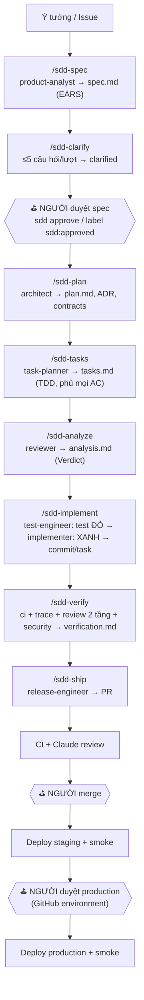

# Quy trình phát triển: Spec-Driven, 100% Claude agents

> Tài liệu cho **con người** trong team. Agent đọc `CLAUDE.md` + `.claude/`; hai bên dùng chung quy tắc.

## 1. Triết lý

1. **Spec là nguồn chân lý.** Không có dòng code nào nếu chưa có spec được *người* duyệt. Code phục vụ spec; spec sai thì sửa spec (và duyệt lại), không "chữa cháy" ở code.
2. **Agent làm 100% công việc, người giữ 2 quyết định:** duyệt spec (làm *cái gì*) và duyệt deploy production.
3. **Gate phải deterministic.** Không tin lời agent "đã xong": CLI `sdd`, hook và CI kiểm tra bằng máy (format spec, độ phủ AC, test đỏ→xanh, traceability, verdict).
4. **Mỗi phase một context sạch, bàn giao qua file.** Phase sau chỉ đọc artifact trên đĩa, không dựa vào "trí nhớ" hội thoại.
5. **Người viết không tự chấm.** Reviewer + security-auditor độc lập, hoài nghi, review 2 tầng (đúng spec → chất lượng code).

## 2. Pipeline



Trạng thái feature (frontmatter `spec.md`, chỉ đổi qua CLI):
`draft → clarified → approved → planned → tasked → implementing → verified → shipped`

## 3. Vai trò agent (`.claude/agents/`)

| Agent | Model | Sở hữu | Ghi chú |
|-------|-------|--------|---------|
| product-analyst | opus | `spec.md`, `steering/product.md` | Chỉ WHAT/WHY, EARS, đánh dấu `[NEEDS CLARIFICATION]` |
| architect | opus | `plan.md`, `research.md`, `data-model.md`, `contracts/`, ADR, `steering/tech.md`, toolchain | Không sửa requirement |
| task-planner | sonnet | `tasks.md` | Test trước impl, mọi AC được phủ |
| test-engineer | sonnet | test, bằng chứng verify | Không viết code production; test phải ĐỎ đúng lý do |
| implementer | sonnet | code `src/`, `progress.md` | 1 task = 1 commit; **hook chặn sửa test** |
| reviewer | opus | `analysis.md`, review | Hoài nghi, 2 tầng, không sửa code |
| security-auditor | opus | báo cáo bảo mật | Read-only |
| release-engineer | sonnet | CI/CD, Dockerfile, runbook, CHANGELOG, PR | Không bao giờ deploy prod |

Đổi model: sửa `model:` trong frontmatter agent (`opus` / `sonnet` / `haiku` / `inherit`).

## 4. Ba cách vận hành

### 4.1 Tương tác trong Claude Code (khuyên dùng khi mới bắt đầu)

```text
/sdd-init <mô tả sản phẩm, ràng buộc, hosting>      # 1 lần: chọn stack, ADR, toolchain, walking skeleton
/sdd-spec <ý tưởng tính năng>
/sdd-clarify 001
# ⛳ tự đọc specs/001-*/spec.md rồi chạy Ở TERMINAL CỦA BẠN (agent bị chặn lệnh này):
node .sdd/scripts/sdd.mjs approve 001 --by "Tên bạn"
/sdd-auto --feature 001                              # plan → tasks → analyze → implement → verify
/sdd-ship 001                                        # mở PR
/sdd-status                                          # xem tiến độ bất kỳ lúc nào
```

### 4.2 Headless trên máy (chạy dài, không giám sát)

```bash
node .sdd/scripts/sdd.mjs pipeline "Người dùng đăng nhập bằng email + OTP"   # spec → clarify, dừng ở gate duyệt
node .sdd/scripts/sdd.mjs approve 001 --by "Tên bạn"
node .sdd/scripts/sdd.mjs pipeline --feature 001                              # plan … verify
node .sdd/scripts/sdd.mjs pipeline --feature 001 --dry-run                    # xem sẽ chạy gì
```

Mỗi phase là một phiên `claude -p` **mới** (context sạch); phase `implement` tự lặp nhiều phiên tới khi hết task
hoặc không còn tiến triển. Giữa các phase CLI kiểm tra gate. Chi phí mỗi phase bị chặn bởi
`pipeline.maxBudgetUsdPerPhase` (mặc định 15 USD) và `maxTurnsPerPhase` trong `.sdd/config.json`. Lưu ý: chế độ headless dùng
`permissionMode` trong `.sdd/config.json` (mặc định `acceptEdits` + allowlist trong `.claude/settings.json`);
lệnh nằm ngoài allowlist sẽ bị từ chối. Muốn chạy hoàn toàn tự động an toàn hơn, chạy trong devcontainer/VM cô lập.

### 4.3 GitHub-native (team)

| Bước | Ai | Hành động | Workflow |
|------|----|-----------|----------|
| 1 | Bất kỳ ai | Tạo issue bằng template *Feature request* | — |
| 2 | Maintainer | Gắn label `sdd:spec` | `sdd-spec.yml` → draft PR chứa spec |
| 3 | Reviewer | Đọc spec; yêu cầu sửa bằng comment `@claude …` | `claude.yml` |
| 4 | Reviewer | Gắn label `sdd:approved` | `sdd-build.yml`: ghi nhận người duyệt → plan … verify → PR ready |
| 5 | — | CI + Claude review tự chạy | `ci.yml`, `claude-review.yml` |
| 6 | Reviewer | Merge PR | `deploy.yml` → staging + smoke |
| 7 | Release manager | Tạo GitHub Release `vX.Y.Z` → duyệt environment `production` | `deploy.yml` → production + smoke |

Thiết lập 1 lần: xem [runbooks/deploy.md](runbooks/deploy.md#one-time-setup-github--settings).

## 5. Quality gates

| Gate | Kiểm tra bởi | Điều kiện |
|------|--------------|-----------|
| Spec hợp lệ | `sdd check` | REQ có AC; AC đúng EARS; không còn `[NEEDS CLARIFICATION]` (từ `clarified`) |
| ⛳ Duyệt spec | **Người** | `sdd approve` / label; agent bị hook chặn |
| Plan | `sdd gate plan` | Spec `approved`; plan có Constitution Check, nhắc mọi REQ |
| Tasks | `sdd check` | Mọi AC có task; task chỉ tham chiếu AC tồn tại |
| Analyze | `sdd gate implement` | `analysis.md` Verdict ≠ FAIL |
| TDD | test-engineer + orchestrator | Test đỏ đúng lý do trước khi code; xanh sau |
| Verify | `sdd set-status verified` | Hết task, `verification.md` PASS, **trace không gap** (mọi AC có test trích `NNN:AC-x.y`) |
| PR | CI + Claude review + người | `sdd ci` xanh, không finding CRITICAL/HIGH |
| ⛳ Production | **Người** | GitHub environment `production` (required reviewers) |

## 6. Guardrails (hooks — `.claude/hooks/`, có test trong `.sdd/scripts/test/hooks.test.mjs`)

| Hook | Chặn |
|------|------|
| `guard-bash` | Agent tự `approve` spec, deploy production, force-push, push lên `main`, `reset --hard`, `--no-verify`, `rm -rf /`, `curl \| sh`, đọc `.env`, `sudo`, publish package, `kubectl/terraform apply`, ghi đè file harness qua shell |
| `guard-files` | Sửa `.env`/key, lockfile, `.git/`, **harness** (`.claude/`, `CLAUDE.md`, `.sdd/scripts`, `.sdd/templates`, `.mcp.json`), constitution, khối `gates` trong `.sdd/config.json`, trường `status/approved_*` của spec, **mọi sửa đổi spec đã approved** |
| `guard-tests` (chỉ implementer) | Sửa/tạo file test |
| `format-on-edit` | — (tự format file vừa sửa bằng `toolchain.format`) |
| `session-start` | — (nạp trạng thái pipeline vào context mỗi phiên) |
| `stop-clean-tree` | Phiên headless kết thúc khi còn thay đổi chưa commit |

**Bảo trì harness (dành cho người):** tạo `.claude/settings.local.json` (đã gitignore) với
`{"env": {"SDD_ALLOW_HARNESS_EDIT": "1"}}`, khởi động lại Claude Code, sửa, rồi **xóa** biến này.
Tương tự: `SDD_ALLOW_CONSTITUTION_EDIT`, `SDD_ALLOW_SPEC_EDIT`. Agent không thể tự bật vì file đó cũng bị chặn.

## 7. Toolchain contract

Mọi nơi (agent, hook, CI, người) chạy cùng lệnh: `node .sdd/scripts/sdd.mjs run <task>`. Lệnh thật nằm ở
`.sdd/config.json → toolchain` (do `/sdd-init` điền). Đổi stack = sửa 1 object JSON.

| Task | Ý nghĩa |
|------|---------|
| `install` | Cài dependency (CI dùng) |
| `format` | Format; nhận đường dẫn file ở cuối (hook truyền vào) |
| `lint`, `typecheck`, `test`, `test:e2e`, `build` | Như tên |
| `start`, `smoke` | Chạy app; smoke test nhận base URL |
| `deploy:staging`, `deploy:production` | Deploy (chỉ CI gọi) |

`sdd ci` = `lint → typecheck → test → build → check --all`. Task chưa cấu hình được **bỏ qua có thông báo**
(riêng deploy production bắt buộc phải có).

## 8. Quy ước quan trọng

- **Test trích dẫn AC:** mỗi test chứng minh một AC phải chứa `NNN:AC-x.y` trong tên/docstring, ví dụ
  `it('[003:AC-2.1] từ chối token hết hạn', …)`. Đây là cách `sdd trace` nối spec ↔ test.
- **Commit:** Conventional Commits theo task: `feat(003): T012 add token refresh`.
- **Ngôn ngữ:** văn bản artifact theo `project.docsLanguage` (`vi`); ID, từ khóa EARS, heading, code, commit giữ tiếng Anh.

## 9. Xử lý sự cố

| Tình huống | Làm gì |
|------------|--------|
| Gate đóng | `node .sdd/scripts/sdd.mjs gate <phase> <id>` → đọc lý do → quay lại phase sở hữu artifact đó |
| Task `[!]` blocked | Đọc ghi chú trong `tasks.md` + `progress.md`; sửa nguyên nhân gốc (thường ở plan/spec) rồi `sdd task T### todo` |
| Spec cần đổi sau khi duyệt | `sdd set-status <id> draft --reason "…"` → sửa → clarify → **duyệt lại** |
| `implement` không tiến triển | Thường do task quá to hoặc plan mơ hồ → `/sdd-analyze` lại, chia nhỏ task |
| CI bot push không kích hoạt CI | Đặt secret `SDD_BOT_TOKEN` (GitHub App/PAT) — push bằng `GITHUB_TOKEN` không trigger workflow |
