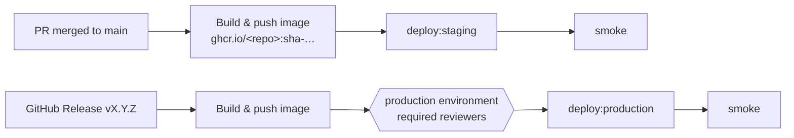

# Runbook — Deploy

Owner: release-engineer (kept truthful by `/sdd-ship` and `/sdd-init`). Pipeline: `.github/workflows/deploy.yml`.

## Flow

## One-time setup (GitHub → Settings)

1. **Secrets:** `ANTHROPIC_API_KEY` (or `CLAUDE_CODE_OAUTH_TOKEN`), optional `SDD_BOT_TOKEN`
   (GitHub App / fine-grained PAT so bot pushes trigger CI), plus deploy credentials per environment.
2. **Environments:** create `staging` and `production`. On `production` add *required reviewers* and
   restrict deployment to tags `v*`. Set variables `STAGING_URL` / `PRODUCTION_URL`.
3. **Branch protection on `main`:** require PR, CI checks (`Harness self-test`, `Lint · Typecheck · Test · Build · Spec gates`),
   1 approval, Code Owners review, linear history; disallow force-push.
4. **Labels:** `sdd:spec`, `sdd:approved` (e.g. `gh label create sdd:spec -c 1D76DB` …).
5. Install the Claude GitHub App (`/install-github-app` in Claude Code) or configure the secret manually.

## Toolchain commands (`.sdd/config.json`)

| Key | Contract |
|-----|----------|
| `deploy:staging` | Deploys `$IMAGE_DIGEST` (or builds) to staging. Idempotent. Non-zero exit on failure. |
| `deploy:production` | Same for production. Must support redeploying an older ref (rollback). |
| `smoke` | Takes the base URL as first argument; checks health + one critical path; non-zero on failure. |

Status:

- `smoke` — **configured**: `node scripts/smoke.mjs <url>` checks `/api/health`, `/api/ready` (MongoDB)
  and the SPA, retrying for 120 s.
- Image — **configured**: one container (the NestJS API serves `/api` + SPA), port `8080`, `HEALTHCHECK` on
  `/api/health`. Runtime env: `MONGODB_URI` (secret), `LOG_LEVEL`, `PORT` — see `.env.example`.
- `deploy:staging` / `deploy:production` — **NOT CONFIGURED**: the hosting target is not chosen yet
  (ADR-0003). Any container platform works (Cloud Run, Azure Container Apps, ECS/Fargate, Fly.io,
  Kubernetes) with MongoDB Atlas or self-hosted MongoDB 8. The command must deploy
  `ghcr.io/<repo>@$IMAGE_DIGEST`.

## Releasing to production

1. Ensure `main` is green and staging smoke passed.
2. Create a release `vX.Y.Z` (notes from `CHANGELOG.md` → move *Unreleased* into the version).
3. Approve the `production` deployment in the Actions run. Watch the smoke step and dashboards.
